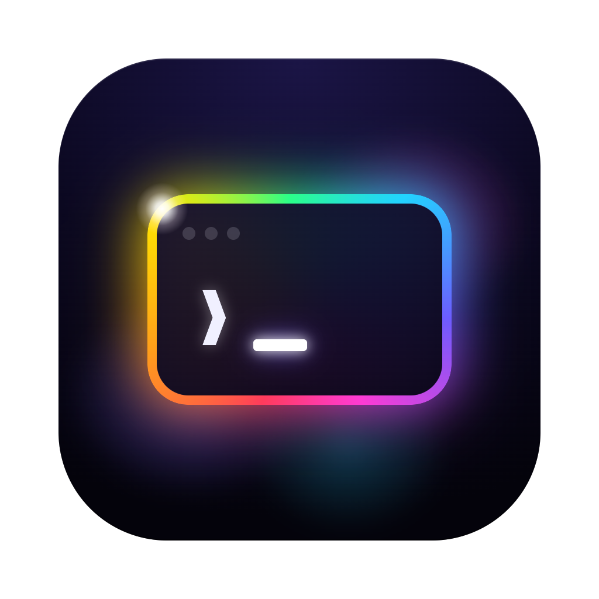
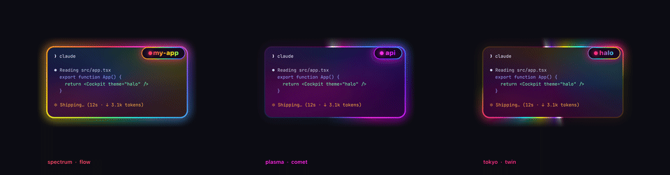
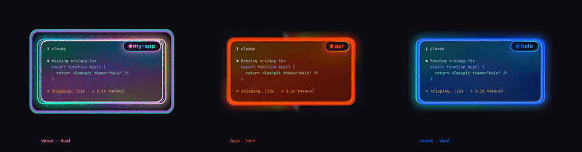
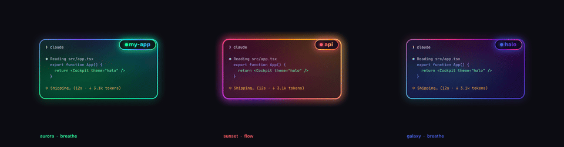
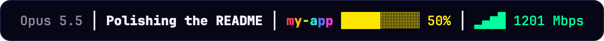
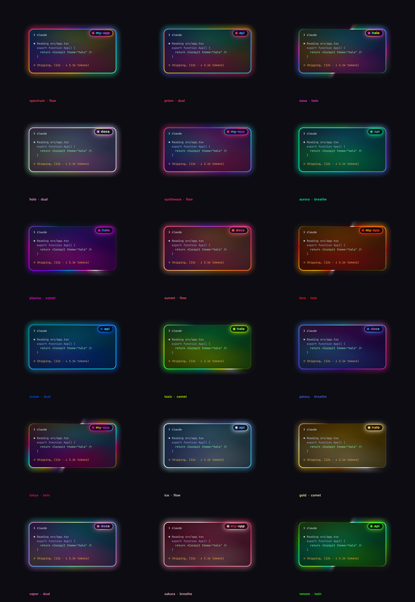

<p align="center">
  
</p>

<h1 align="center">Halo</h1>

<p align="center">
  Every Claude Code session gets its own animated identity in Ghostty: a glowing outline, an aurora<br>
  behind the glass, the project's colours, and effects that react to every keystroke.
</p>

<p align="center">
  
</p>

Run five Claude Code sessions at once and every window looks the same. Halo gives each project a
permanent colour identity, so you know which agent is which at a glance, and makes the terminal feel
alive while you work.

## What you get

- **A permanent identity per project.** The first time Claude runs in a project, Halo gives it one of
  18 identities and keeps it: same project, same colours, every session. Sessions started in your home
  folder light up too, in `tokyo`.
- **An animated outline and glow** around the window, in one of five motion styles: `flow`, `dual`,
  `comet`, `twin`, `breathe`. Only the focused window animates; the others dim and hold still.
- **An aurora behind the glass**, drifting through Ghostty's translucent background.
- **A project badge** in the title bar, the project name in its identity gradient.
- **The terminal in the project's colours:** background and cursor, plus the tmux status bar and pane
  borders when Claude runs inside tmux.
- **Effects that react to you** (below), around the window and inside it.
- **A full statusline:** model, current task, project, context used, Wi-Fi speed.

## See it

### Return sends a supernova



The outline flares white and wobbles, shockwaves fly off in the identity colours and sparks burst off
every edge. Inside Ghostty at the same moment, the terminal shakes, a rainbow shockwave bends the text
as it sweeps past, the screen flashes and the input box lines blaze.

### Focus



Switch to a window and its colours whoosh once around the outline before settling into their flow.

### The statusline



Model, the task Claude is on, the project in its colours, how much context is used (green, yellow,
orange, then red as auto-compact gets close) and your Wi-Fi link rate.

### All 18 identities



## Effects

| You | Around the window | Inside Ghostty |
| --- | --- | --- |
| Type | The glow brightens; steady typing keeps it lit | The input box lines light up under the cursor |
| Return | Flare, jelly wobble, shockwaves, sparks | Shake, a shockwave that bends the text, flash, falling sparks |
| Cmd+V | A stream of light dots runs around the outline | The pasted text beams in behind a scan line |
| Ctrl+U | The outline blinks out and back | A strike-through slashes across the erased line |
| Focus a window | The colours whoosh once around | |
| Move, resize, Cmd+M | The halo steps aside and comes back when the window settles | |

## Install

Halo needs macOS 14 or later and **[Ghostty](https://ghostty.org)**. Its in-terminal effects are a
Ghostty shader and the aurora needs Ghostty's translucent background, which Apple Terminal can't do.
No Ghostty yet? The installer offers to install it with Homebrew.

```sh
git clone https://github.com/johnlegoat/halo.git
cd halo
./install.sh
```

You also need the Xcode Command Line Tools (`xcode-select --install`) and Node, which Claude Code's
statusline runs on.

The installer:

1. builds `~/Applications/Halo.app` and starts it now and at every login,
2. installs the shader and adds a marked Halo block to your Ghostty config, after backing it up (with
   no Ghostty config yet, you also get Halo's midnight-blue look),
3. installs the statusline and turns it on in `~/.claude/settings.json`, unless you already have one.

Then allow Halo when macOS asks (Accessibility, and Automation for Ghostty), reload Ghostty's config
with Cmd+Shift+, and run `claude` in a project folder.

### Already have a statusline?

The installer leaves yours alone. Halo learns which window each session runs in from the statusline,
so either point `statusLine` at `~/.claude/hooks/halo-statusline.js`, or add this to yours (`data`
is the JSON Claude Code sends it on stdin):

```js
try { project = require(require('os').homedir() + '/.claude/hooks/halo-identity').identify(data); } catch (e) {}
```

`identify(data)` must run on every render. It returns the project name painted in its colours, or
`null` outside a project.

## How it works

```
Claude Code ── statusline ──▶ halo-identity.js ──▶ ~/.cache/halo/sessions/<id>.json
                                     │               (pid, tty, project, identity)
                                     ▼                          │
                      ~/.config/halo/identities.json            ▼
                      (palettes, project → identity) ──▶  Halo.app
                                                           ├─ Ghostty AppleScript: tty → window
                                                           ├─ Accessibility: frames, focus, key timing
                                                           ├─ overlay below each window (Core Animation)
                                                           └─ OSC 11/12 → colours + halo-type.glsl
```

- **Event-driven.** Accessibility and workspace notifications, a directory watch and process-exit
  sources drive everything; nothing polls. Core Animation runs the animations in the window server,
  so Halo itself stays idle.
- **Shader frames on demand.** With `custom-shader-animation = false`, Ghostty runs the shader only
  when it redraws. Halo asks for frames only while an effect plays, so idle terminals cost nothing.
- **A clock in the cursor colour.** Return, paste and Ctrl+U reach the shader as cursor colours: during
  the explosion the cursor is `#ffffBB`, with `BB` counting down from `ff` to `00`.
- Halo respects Reduce Motion.

## Customize

`~/.config/halo/identities.json` is created the first time a session starts:

```json
{
  "settings": { "cornerRadius": 16, "glow": 26, "line": 2, "aurora": true },
  "identities": {
    "spectrum": { "colors": ["#ff3b5c", "#ff9f1a", "#ffe600", "#2bff88", "#22d3ff", "#6c5cff", "#ff3bd4"], "style": "flow", "bg": "#0b0820" }
  },
  "projects": { "/Users/you/code/my-app": "spectrum" }
}
```

- `style` is `flow`, `dual`, `comet`, `twin` or `breathe`; add `"period": 6` to set the seconds per lap.
- `bg` is the terminal background for that identity.
- `projects` maps each project to its identity: change a value to recolour a project. A new project
  gets a free identity, picked from a hash of its path.
- Halo re-reads the file on its next update (a session starting or ending, a window change).

Render every identity without opening a window:

```sh
swiftc -O -o build/Halo src/Halo.swift
build/Halo --preview sheet.png 3          # t = 3 s;  --boom for the Return explosion, --focus for focus-in
node scripts/demo.js                      # re-renders the GIFs in this README (needs ffmpeg)
```

## Privacy

- Halo makes no network requests. The Wi-Fi rate is the link speed macOS reports locally, not a speed test.
- Halo watches key events only for their timing and to recognise Return, Cmd+V, Ctrl+U and Cmd+M. It
  never reads or stores what you type.
- Everything stays on your Mac: `~/.config/halo` (identities), `~/.cache/halo` (live sessions) and
  `~/Library/Logs/Halo.log` (`touch ~/.config/halo/debug` for verbose logs).

## Uninstall

```sh
./uninstall.sh
```

This removes the app, the login item, the statusline files, the shader and the Halo block in your
Ghostty config. It keeps `~/.config/halo`. If `statusLine` in `~/.claude/settings.json` points at
`halo-statusline.js`, remove or replace it.

## License

MIT. Halo is not affiliated with Ghostty or Anthropic.
